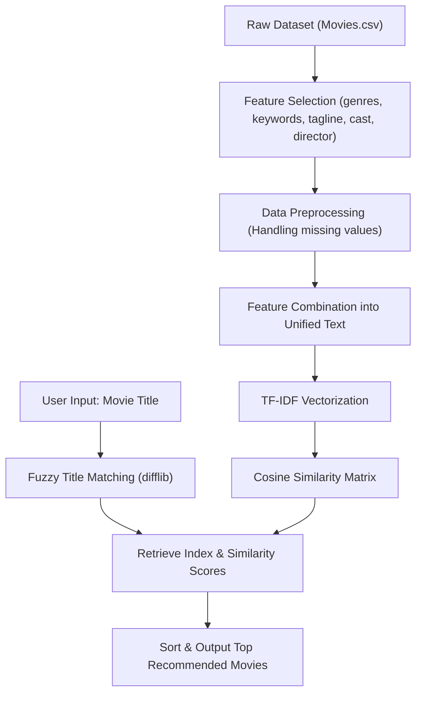

# Movie Recommendation System 🎬

A content-based Movie Recommendation System built with Python, scikit-learn, and pandas. The system suggests movies similar to a user's favorite film by analyzing features such as genres, keywords, tagline, cast, and director using **TF-IDF Vectorization** and **Cosine Similarity**.

---

## 📌 Features

- **Content-Based Filtering**: Analyzes metadata of movies including genres, key plot themes, director, cast, and tagline.
- **TF-IDF Vectorization**: Transforms textual movie descriptions and metadata into high-dimensional numerical feature vectors.
- **Cosine Similarity Metric**: Computes pairwise cosine distance between movie vectors to find the most contextually relevant titles.
- **Fuzzy Title Matching**: Uses Python's built-in `difflib` to match movie names even if there are typos or partial titles (e.g. typing "iron man" or "batman").
- **Flexible Interface**: Run interactively via **Jupyter Notebook** (`My project.ipynb`) or instantly via terminal using **Python CLI** (`recommend.py`).

---

## 🛠️ Tech Stack & Libraries

- **Language**: Python 3.10+
- **Data Analysis**: Pandas, NumPy
- **Machine Learning & NLP**: Scikit-Learn (`TfidfVectorizer`, `cosine_similarity`)
- **String Matching**: `difflib`
- **Environment**: Jupyter Notebook / Google Colab / Python CLI

---

## 📂 Project Structure

```
Movie-Recommendation-System/
├── Movies.csv               # Movie metadata dataset (titles, genres, cast, crew, etc.)
├── My project.ipynb         # Interactive Jupyter Notebook with end-to-end analysis
├── recommend.py             # Standalone Python CLI recommendation script
├── requirements.txt         # Required Python dependencies
├── .gitignore               # Ignored cache & virtual environment files
└── README.md                # Project documentation
```

---

## ⚙️ How It Works



1. **Feature Engineering**: Relevant textual attributes (`genres`, `keywords`, `tagline`, `cast`, `director`) are selected and merged into a single combined feature string for each movie.
2. **Vector Space Model**: `TfidfVectorizer` converts the combined text strings into a TF-IDF feature matrix, scoring words based on term frequency and inverse document frequency.
3. **Similarity Calculation**: Pairwise `cosine_similarity` scores are calculated across all movies in the dataset.
4. **Recommendation Generation**: When a movie title is requested, the system finds the closest matching title in the database, retrieves its similarity vector, sorts other movies by similarity in descending order, and displays the top recommendations.

---

## 🚀 Getting Started

### 1. Clone the Repository
```bash
git clone https://github.com/upendrareddy3464/Movie-Recommendation-System.git
cd Movie-Recommendation-System
```

### 2. Set Up a Virtual Environment (Optional but Recommended)
```bash
python -m venv .venv

# On Windows:
.\.venv\Scripts\Activate.ps1

# On macOS/Linux:
source .venv/bin/activate
```

### 3. Install Dependencies
```bash
pip install -r requirements.txt
```

---

## 💻 Usage

### Option A: Run via Python CLI
```bash
# Interactive prompt:
python recommend.py

# Or pass a movie title directly:
python recommend.py "Avatar"
```

### Option B: Run via Jupyter Notebook
Launch Jupyter Notebook and open `My project.ipynb`:
```bash
jupyter notebook "My project.ipynb"
```

---

## 📊 Sample Output

```text
Enter your favourite movie name : Avatar

Top match in database: 'Avatar'

Movies suggested for you (based on 'Avatar'):
--------------------------------------------------
 1. Avatar                                   (similarity: 1.000)
 2. Guardians of the Galaxy                  (similarity: 0.284)
 3. Star Trek Beyond                         (similarity: 0.252)
 4. Star Trek Into Darkness                  (similarity: 0.231)
 5. Terminator Salvation                     (similarity: 0.218)
 6. Furious 7                                (similarity: 0.198)
 7. X-Men: Days of Future Past               (similarity: 0.194)
 8. Oz: The Great and Powerful               (similarity: 0.187)
 9. John Carter                              (similarity: 0.182)
10. Superman Returns                         (similarity: 0.179)
```

---

## 👤 Author

Developed by **Upendra Reddy**
- GitHub: [@upendrareddy3464](https://github.com/upendrareddy3464)
